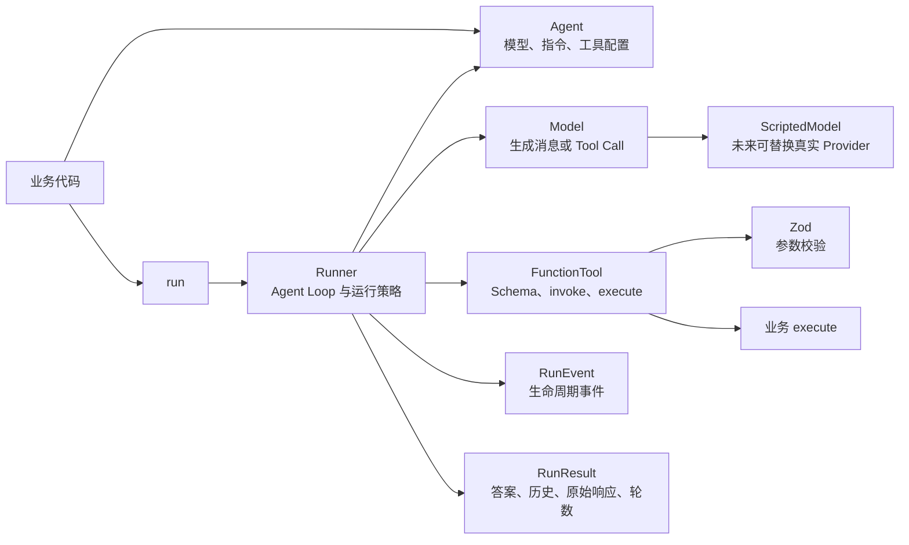
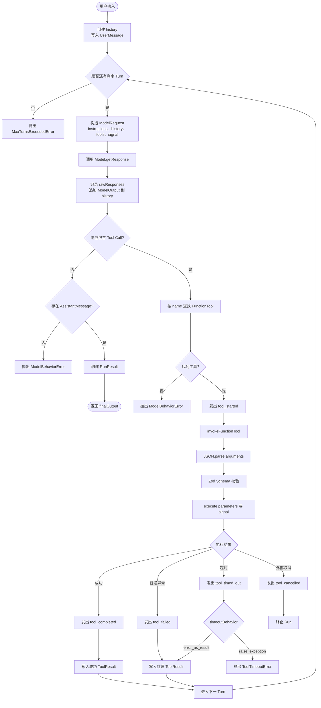
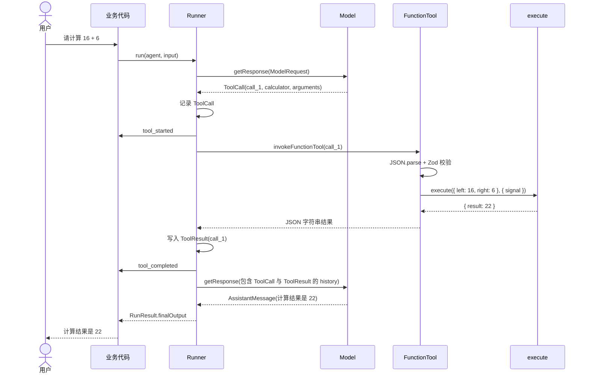
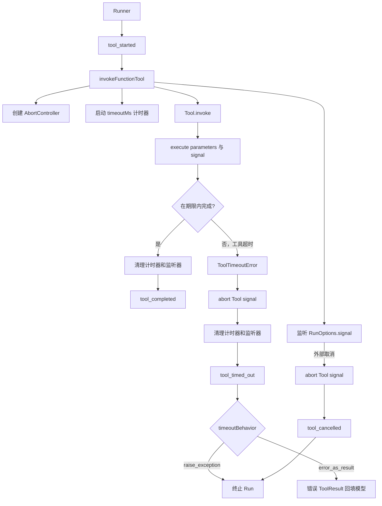
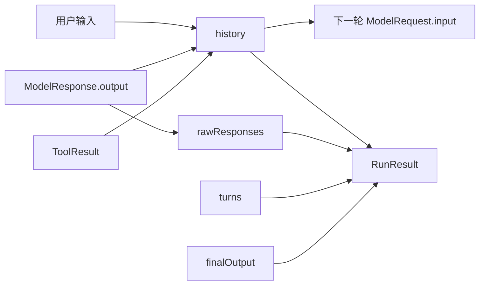
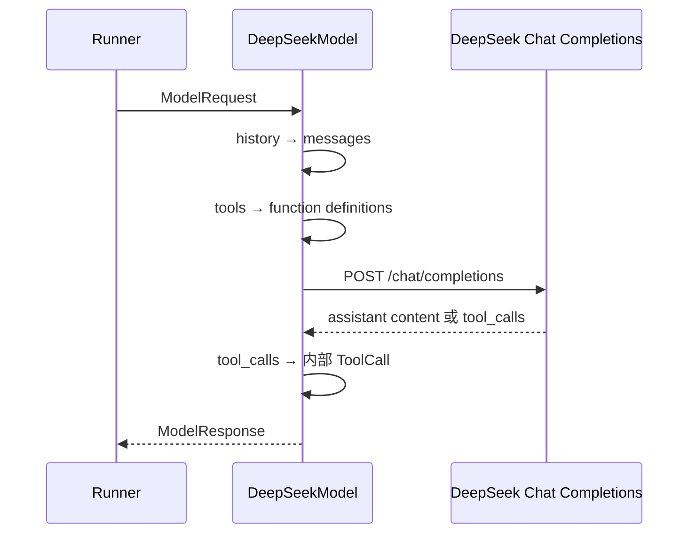
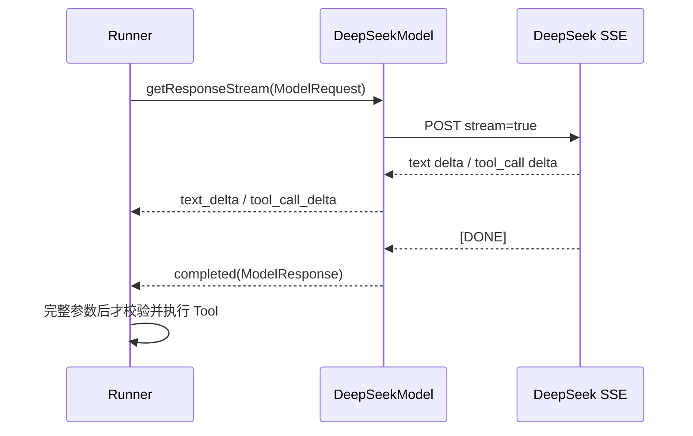

# Minimal Agent Runtime 运行流程

本文描述当前 `minimal-agent-runtime` 的模块职责、Agent Loop、工具调用、超时、取消和事件流。

## 1. 模块架构



模块边界：

| 模块 | 负责 | 不负责 |
|---|---|---|
| `Agent` | 保存模型、指令和工具 | 不执行循环和工具 |
| `Model` | 根据请求返回消息或 Tool Call | 不直接执行工具 |
| `FunctionTool` | 描述工具、校验参数、调用业务函数 | 不决定何时再次调用模型 |
| `Runner` | 驱动循环、执行工具、应用超时策略、维护历史 | 不实现具体业务能力 |
| `RunEvent` | 暴露可观测的语义事件 | 不承载隐藏推理过程 |
| `RunResult` | 汇总最终输出和运行记录 | 不继续驱动循环 |

## 2. 完整 Agent Loop



关键停止条件：

- 没有 Tool Call 且存在 AssistantMessage：正常结束。
- 超过 `maxTurns`：抛出 `MaxTurnsExceededError`。
- 模型请求未注册工具：抛出 `ModelBehaviorError`。
- Tool 超时且策略为 `raise_exception`：抛出 `ToolTimeoutError`。
- 外部 `AbortSignal` 取消：终止本次 Run。

## 3. 正常 Tool Calling 时序



`callId` 用于关联一次具体调用与结果：

```text
ToolCall.callId == ToolResult.callId
```

同一轮多次调用相同工具时，不能只依赖工具名匹配结果。

## 4. 超时与取消流程



注意：

> `Promise.race()` 只能让 Runtime 停止等待。业务 `execute()` 及其调用的 HTTP、数据库客户端必须响应 `AbortSignal`，底层任务才会真正停止。

## 5. 错误处理矩阵

| 场景 | 事件 | History | Run 是否继续 |
|---|---|---|---|
| Tool 正常完成 | `tool_started` → `tool_completed` | 成功 `ToolResult` | 是 |
| JSON、Zod 或业务异常 | `tool_started` → `tool_failed` | 错误 `ToolResult` | 是，模型可修正 |
| Tool 超时，`error_as_result` | `tool_started` → `tool_timed_out` | 错误 `ToolResult` | 是 |
| Tool 超时，`raise_exception` | `tool_started` → `tool_timed_out` | 不写超时结果 | 否 |
| 外部取消 | `tool_started` → `tool_cancelled` | 不写取消结果 | 否 |
| Tool 未注册 | 无 Tool 事件 | 已记录模型的 `ToolCall` | 否 |
| 超过最大轮数 | 之前的历史保留 | 保留已执行记录 | 否 |

## 6. 状态数据流



- `history`：标准化运行状态，用于下一轮输入、恢复和重放。
- `rawResponses`：保存每轮原始模型响应，用于追踪和故障定位。
- `RunEvent`：实时通知运行阶段，不替代持久化状态。
- `RunResult`：运行结束后的汇总结果。

## 7. 代码导航

| 阅读顺序 | 文件 | 关注点 |
|---|---|---|
| 1 | `examples/calculator.ts` | SDK 使用者如何定义 Tool、Agent 和事件监听 |
| 2 | `src/model.ts` | 模型请求、响应和 History 协议 |
| 3 | `src/tool.ts` | Schema、`invoke()`、超时和取消机制 |
| 4 | `src/agent.ts` | Agent 配置边界 |
| 5 | `src/runner.ts` | Agent Loop、错误策略和事件分发 |
| 6 | `src/events.ts` | 生命周期事件类型 |
| 7 | `src/result.ts` | 最终结果结构 |
| 8 | `tests/tool.test.ts` | Tool 单元测试 |
| 9 | `tests/runner.test.ts` | Runtime 集成测试 |
| 10 | `src/deepseek-model.ts` | DeepSeek Chat Completions 与内部协议的适配 |
| 11 | `examples/deepseek-calculator.ts` | 真实模型的 Tool Calling 示例 |

## 8. DeepSeek Provider 映射



关键协议映射：

| 内部协议 | DeepSeek Chat Completions |
|---|---|
| `instructions` | `messages` 中的 `system` |
| `UserMessage` | `role: user` |
| `AssistantMessage` | `role: assistant` |
| `ToolCall` | `assistant.tool_calls[]` |
| `ToolResult` | `role: tool` + `tool_call_id` |
| `FunctionTool` | `tools[].type = function` |

API Key 只从 `DEEPSEEK_API_KEY` 环境变量或构造参数读取，不进入 `RunResult`、事件或错误信息。

## 9. 流式执行

当前已实现最小流式 Provider 和 Runner：



文本可以立即增量展示；Tool Call 的 name 和 arguments 必须在 Provider 层聚合完成，
再由 Runner 进入和非流式相同的 Schema 校验、超时、取消和错误处理流程。

## 10. 当前未实现

```text
Guardrails 与人工审批
Handoffs 与 Agent as Tool
Session、持久化与中断恢复
Tracing 与 Usage
MCP、Hosted Tools、Realtime 与 Sandbox
完整生产级 Streaming reconciliation、Usage 和 Trace
```

这些能力应在当前 Agent Loop、超时、取消和事件流完全理解后逐层加入。
